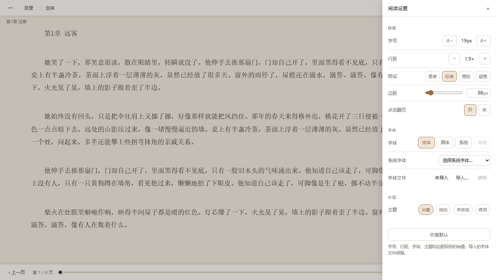

# Novel Reader

Windows 本地小说阅读器。完全离线、零副本：书只被索引，永远读原文件。

支持 TXT / EPUB，导入后按目录分组上架，用 CSS 多栏分页阅读，带全文搜索、进度记忆、字体导入和四套阅读主题。
界面用暖纸色系，没有账号、没有云同步、没有遥测。

## 界面

**书架** — 五级目录树、继续阅读条、书卡显示作者 / 字数 / 章节 / 进度


**阅读页** — CSS 多栏分页，工具栏自动隐藏，点正文两侧翻页


**阅读设置** — 字号、行距、边距、字体、主题，可一键恢复默认



## 功能

**导入与书架**

- 多选 txt / epub，或直接把文件拖进窗口
- 「导入文件夹」递归扫描整个目录，按磁盘子文件夹自动建分组，同级同名目录合并
- 最多 5 级目录，支持新建 / 重命名 / 移动 / 删除（只删记录，不动磁盘文件）
- 书卡拖进目录、目录拖拽排序、书卡「⋯」菜单管理
- 继续阅读条、可折叠目录树（带书数）、全库搜索（结果标目录全路径）
- 排序：最近活动 / 最近添加 / 书名 / 最近阅读 / 进度 / 章节数，可倒序
- 书卡显示作者、全书字数、当前章 / 总章数、阅读进度

**阅读**

- CSS 多栏分页，翻页只做 `translateX`，不重排正文
- 点击正文左 / 右 30% 翻页，点中间唤出工具栏；左右圆形按钮也可点
- 键盘：`←` `→` `↑` `↓` `PageUp` `PageDown` `空格` 翻页，`Esc` 返回书架
- 工具栏自动隐藏，指针移到上下边缘才唤出
- 字号 14–32px、行距 1.2–3.0、边距 1px 精度（滑块 + 数字框）
- 四套主题：米黄 / 纯白 / 羊皮纸 / 夜间
- 字体：内置宋体 / 黑体，可直接选系统字体，也可导入本地 ttf / otf / ttc / woff / woff2
- 进度按 `(章节, 章内字符偏移)` 保存，换字号 / 窗口大小不会错位

**搜索**

- `Ctrl+F` 打开全文搜索，命中词在正文里高亮（CSS Custom Highlight，不插 DOM）
- 结果按章节分组，`↑` `↓` 在结果间切换，正文自动跳到命中页
- 结果分页加载，`total` 始终是全书精确命中数

## 技术栈

| 层 | 选型 |
|---|---|
| 壳 | Tauri 2 + WebView2 |
| 引擎 | 纯 Rust `novel-core`，mmap + 字节偏移，零 UI 依赖 |
| 前端 | 原生 TypeScript + Vite，无框架、无 VDOM |
| 存储 | SQLite（rusqlite bundled），单文件 `library.db` |

## 开发

需要 Rust stable（MSVC toolchain）、VS 2022 Build Tools + Windows SDK、Node 20+、pnpm。Win10 需要单独安装 WebView2 Evergreen Runtime，Win11 自带。

```bash
pnpm install

pnpm dev              # 只跑前端，浏览器 http://localhost:1420（mock 数据）
pnpm tauri dev        # 真实 Tauri 窗口
pnpm tauri build      # 只出绿色版 exe（产物在 target/release/）
pnpm release          # 同步到 release/ 并生成 SHA256SUMS.txt
```

引擎侧工具：

```bash
cargo build --release -p novel-cli
cargo test -p novel-core                          # 引擎单元测试
./target/release/novel-cli.exe selftest           # 数据层验收
./target/release/novel-cli.exe bench <文件>        # 性能穿刺
./target/release/novel-cli.exe gen <输出> [MB]     # 造合成语料
```

如果 `cargo` 不在 `PATH`，先把它加进去（rustup 默认装在 `~/.cargo/bin`）。

## 数据与隐私

- 书库只存原文件的**绝对路径**，不复制、不改写、不转码。
- 书架、进度、阅读偏好、窗口状态全部在 `%APPDATA%\com.novelreader.app\library.db`。
  搬走这一个文件就能完整恢复；书架顶栏「设置 → 数据目录」可以整体迁移。
- EPUB 全文搜索会在数据目录下生成 `search-cache/`（纯文本，仅供搜索），随时可删。
- 完全离线，不发起任何网络请求。

## 分发

只提供免安装的 `NovelReader.exe`：下载后放到任意目录双击即可，无需安装、不写注册表。

- 首次运行可能出现 Windows SmartScreen 的「Windows 已保护你的电脑」提示，点
  **更多信息 → 仍要运行**。发布页附带的 `SHA256SUMS.txt` 可用于核对文件完整性。
- 卸载只需删除 exe。书架、进度和偏好保存在 `%APPDATA%\com.novelreader.app\library.db`，
  不会随 exe 删除，需要清理时手动删。
- 未做自动更新，升级就是重新下载 exe 覆盖原文件（覆盖前建议先退出程序）。

## 项目结构

```
crates/novel-core/    Rust 引擎：编码探测、TXT 切章、EPUB 解析、搜索、字体枚举、SQLite 存储
crates/novel-cli/     压测 / 造数据 / 数据层验收工具
src-tauri/           Tauri 命令层（薄包装）与打包配置
src/                 前端：书架、阅读页、分页器、IPC 契约、样式
scripts/             发布、测试 EPUB、图标、示例小说生成脚本
```

更细的模块地图、数据流、设计不变量和改动注意事项在 [AGENTS.md](AGENTS.md)。

## 已知限制

- Windows 专用；目录最多 5 级。
- 不做封面提取，书卡以文字信息为主。
- 翻页无动画；不做双列 / 竖排。
- 个人项目，未做自动更新。

## 文档

- [AGENTS.md](AGENTS.md) — 工程文档：架构、数据流、不变量、回归基线、发布流程
